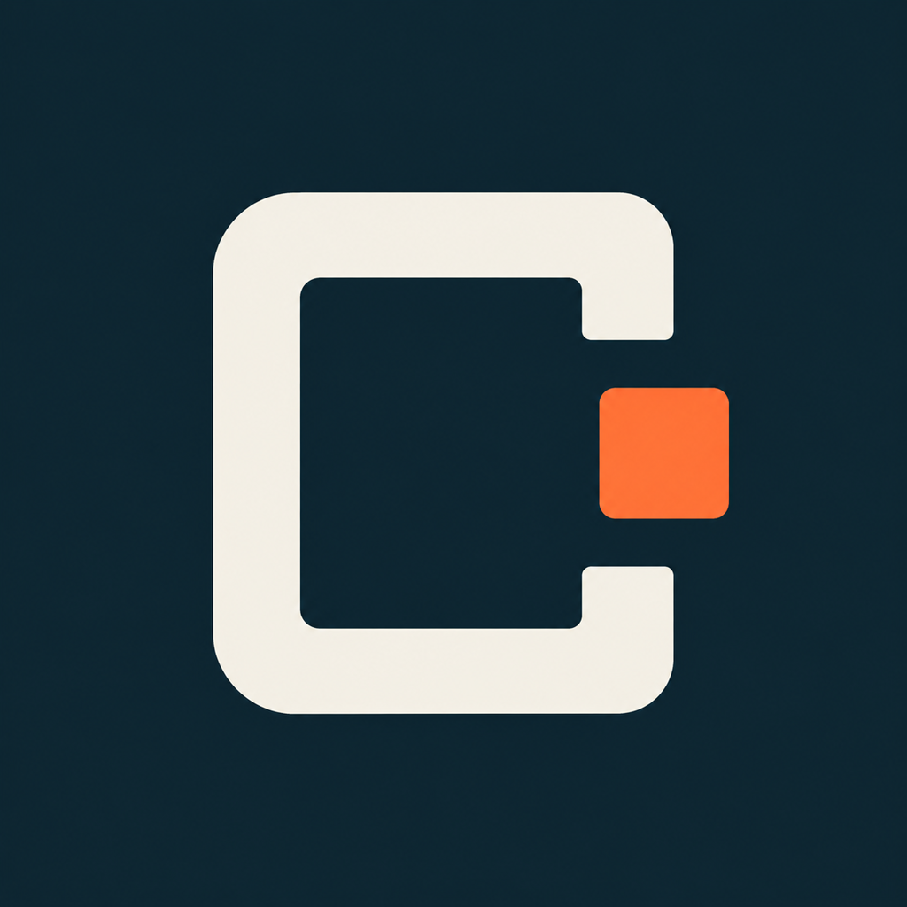

<h1 align="center"> CARLA Agent</h1>
<p align="center"><strong>从一次仿真操作，到一场可追溯的实验。</strong><br>Atomic skills and bounded Auto Research for CARLA.</p>
<p align="center">
  <a href="#从这里开始">开始探索</a> ·
  <a href="docs/skill-catalog-sprint42.md">完整技能目录</a> ·
  <a href="docs/architecture.md">架构</a> ·
  <a href="docs/status.md">进展与边界</a>
</p>

CARLA Agent 把仿真操作、传感器知识和有限参数实验组织成一个 coding-agent 插件。新手可以从一个具体任务认识 Client、World、Actor 和 sensor；熟悉平台后，直接使用专业 skill 或结构化 CLI；Auto Research 则复用相同采集能力组织对照实验。

**Development preview · 源码可试用，正式插件安装演示尚未完成。** CARLA/Unreal 和匹配的 PythonAPI 是外部依赖，本仓库不包含仿真器。当前参考定制 `sprint42` 基线，标准 CARLA 的可用子集需按实际 API 核对。

## 一个项目，三种使用方式

- **理解与操作**：“查看当前地图，解释固定步长如何影响传感器采样。”

  得到：只读观察、具体解释，以及授权范围内的有界操作。

- **采集与检查**：“挂一台 RGB 相机，采集几帧并核对帧号。”

  得到：原始文件、配置、frame/timestamp，以及资源清理结果。

- **提出并检验假设**：“固定场景，比较两组 LiDAR 参数。”

  得到：冻结条件、配对重复、独立确认和有适用范围的比较结果。

这些是任务入口示例，执行前仍会检查环境、能力与任务范围。缺失的 blueprint、版本不匹配或未实现的采集格式会明确返回缺口。

## 专业技能，不止 RGB 和 LiDAR

**107 个领域与组合 skill，另有 2 个旧名兼容入口。** 每个入口都有触发边界、输入输出、原生 API 或命令、失败判断和相邻任务路由。

| 能力域 | 数量 | 代表内容 |
|---|---:|---|
| 运行时、地图、车辆与交通 | 44 | Session、时钟、OpenDRIVE、车辆控制、外部动力学、工程车辆、TM、信号灯、天气、真值与 OSI |
| 传感器 | 25 | 9 种相机、5 种 LiDAR、3 种雷达、IMU、GNSS、超声波、事件与 RSS |
| 工程与资产 | 30 | 环境、构建、资产导入、地图制作、NavMesh、扩展开发与协议 |
| 采集、教学与研究 | 8 | Sensor Rig、Capture、Dataset、Onboarding，以及 4 个 Auto Research 入口 |

看一个具体入口：[双目相机](skills/carla-camera-stereo/SKILL.md) · [MEMS LiDAR](skills/carla-lidar-mems/SKILL.md) · [交通信号](skills/carla-traffic-signals/SKILL.md) · [实验比较](skills/carla-compare/SKILL.md)。

技能数量表示指引覆盖，**不表示 107 项能力都已封装为 CLI 或完成实机验收**。当前共有 **17 个基础原子操作**；其他技能分别标注 `native-api`、`conditional` 或 `workflow`。例如 USD、ROS2 和部分 Editor 地图制作路径有明确的接线/实现缺口。详见[完整目录](docs/skill-catalog-sprint42.md)。

## 从这里开始

先探索技能和输入契约，不需要启动 CARLA。以下是开发 checkout 的试用方式，要求 Python 3.10+：

```bash
git clone https://github.com/yuanhaorannnnnn/carla-autoresearch.git
cd carla-autoresearch
export PYTHONPATH="$PWD/src"

python3 -m carla_agent skills list --category sensors
python3 -m carla_agent skills show carla-camera-stereo
python3 -m carla_agent schema vehicle.control
```

连接实际仿真前，复制 [profile 示例](profiles/examples/local.json)，填写自己的 CARLA Python 解释器和输出目录，再运行：

```bash
python3 -m carla_agent connection doctor --profile /absolute/path/local.json
python3 -m carla_agent world inspect --profile /absolute/path/local.json
```

控制器本身无第三方运行时依赖；CARLA worker 使用 profile 指定的 Python 3.8+ 环境和匹配的 `carla` wheel。不要把开发用 `PYTHONPATH` 当作正式安装步骤。[入门说明](docs/getting-started.md)覆盖只读连接、采集前置与常见能力边界。

## Auto Research：操作能力之上的实验层

```text
问题与条件 → research-plan → benchmark / capture → compare
                               ↑                    ↓
                               └── parameter-search ┘
                                  预算 · 确认 · 恢复
```

- **Research Plan**：定义允许变化的参数、有效性底线、比较阈值与预算。
- **Benchmark**：固定 workload 测量；正式 trial 由同一个控制器记录。
- **Compare**：离线核对冻结输入和原始产物，不为比较重新启动仿真。
- **Parameter Search**：安排候选、独立重复和确认，保留失败轮次，支持停止与恢复。

```bash
python3 -m carla_agent research validate --plan plan.json
python3 -m carla_agent research compare --run /absolute/path/to/completed-run
```

计划需按[研究契约](references/carla-research.md)填写。当前执行器支持同一构建内的 RayCast LiDAR 有限参数 `tradeoff`：比较客户端 tick→callback 延迟，同时检查声明的点数和有限坐标底线。这不是 GPU 内核计时，也不证明几何等价或物理传感器精度；源码自动修改与跨构建优化尚未接入。

## 当前进度

| 已有证据 | 尚待完成 |
|---|---|
| 109 份 skill 结构、引用与离线索引检查 | 干净环境插件安装演示 |
| 85 项相关本地测试；使用 fake/synthetic 输入 | 新增命令与研究闭环的真实运行演示 |
| 6 个独立只读技能边界演练 | 完整 scene/weather/seed provenance 与兼容矩阵 |
| 既有二进制上的 RGB/RayCast 短采集记录 | 公共插件目录上架与正式发行包 |

既有采集包的源码 commit 未核实，因此不能当作 sprint42 构建证明。完整说明见[状态与验证范围](docs/status.md)；后续[安装演示计划](docs/installation-demo.md)已记录，当前先公开项目开发进展。

## 深入阅读与参与

[架构与执行边界](docs/architecture.md) · [17 项基础操作契约](docs/implementation-contract.md) · [共享规则](references/carla-agent-shared.md) · [迁移说明](docs/migration.md) · [参与方式](CONTRIBUTING.md)

欢迎通过 [Issues](https://github.com/yuanhaorannnnnn/carla-autoresearch/issues) 提供具体任务、API/服务端版本和可复现现象。优先补齐已定义操作的真实证据、条件能力适配和新人使用反馈。

项目沿用 `carla-autoresearch` 的 CARLA 开发历史；更早的训练代码源自 [karpathy/autoresearch](https://github.com/karpathy/autoresearch)，保留于 [legacy/training](legacy/training)。旧 CARLA 实现位于 [legacy/carla-v0](legacy/carla-v0)，仅供追溯，不随新工具安装。CARLA Agent 是独立社区项目。
